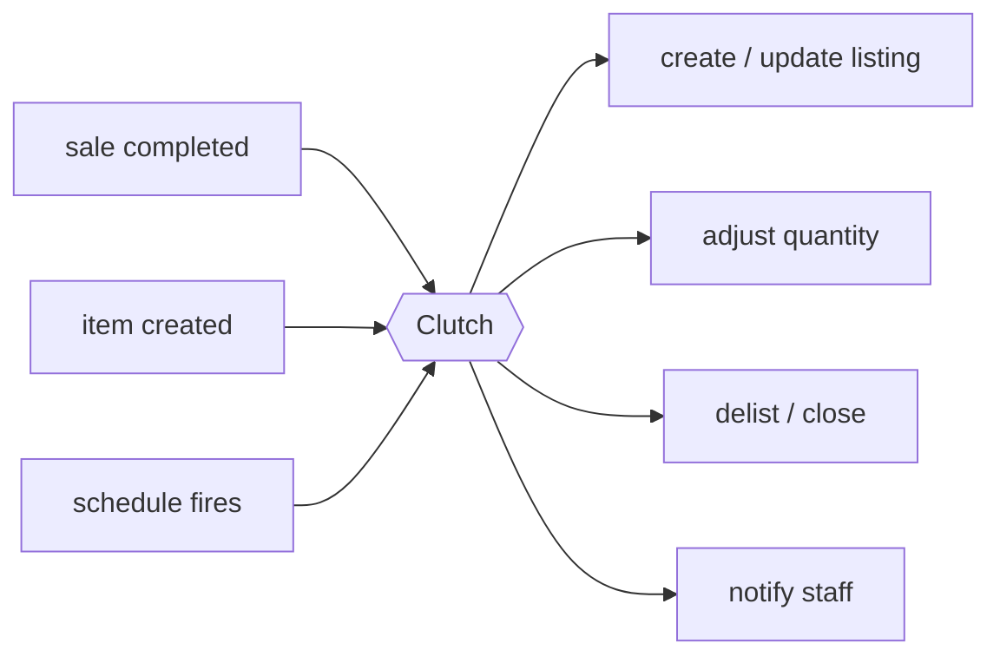

# 01 — Ecosystem

## The systems

| System | Role | Direction | Status |
| --- | --- | --- | --- |
| **Heartland Retail** | System of record for inventory and sales | Event source; action target | Connected |
| **BrickLink** | Sales channel | Action target (event source in phase 2) | First connector |
| **eBay** | Sales channel | Action target (event source in phase 2) | Then |
| **FB Marketplace** | Sales channel | Action target (event source in phase 2) | Then |
| **GroupMe** | Staff notification | Action target only | Carried over from `OperationalHooks` |
| Vendor sites, Patron, … | Not yet characterized | — | Candidates |

Each system is an **event source**, an **action target**, or both. That
classification is the one thing worth knowing about a system before connecting
it, because it decides whether its connector needs inbound plumbing, outbound
plumbing, or both.

## What flows



**Events in.** Today: Heartland's `sales_transaction_completed` and
`item_created` webhooks. Clock ticks count as triggers too — the jobs carried
over from `OperationalHooks` (`undersold-items`, `receive-open-orders`) are
driven by a schedule rather than an event, and they feed the same kinds of
action.

**Actions out.** Listing lifecycle on a channel (create, update, delist),
quantity adjustment, and notification. Writes back to Heartland also count:
item enrichment and purchase-order receiving are actions on the system of
record itself.

## Inventory replication

The first class of work, and the one that defines the product: **what Heartland
says is in stock should be what each channel is offering.**

```
Heartland item + on-hand qty  ──▶  BrickLink inventory lot
                              ──▶  eBay listing
                              ──▶  FB Marketplace listing
```

Three things this requires that no single event carries:

1. **Identity mapping.** Two different mappings, and they should not be
   confused:
   - *Catalog identity* — which product this is in the channel's catalog. Often
     already in the data: `bricklinkId` is a BAM-mandated custom field, so for
     BrickLink this is likely derivable rather than stored.
   - *Listing identity* — our store's listing of that product on that channel,
     with its own price and quantity. Per store, created by us, and nothing in
     Clutch remembers it today. This is the single largest gap in the design;
     see [05 — Open questions](05-open-questions.md).
2. **Catalog translation.** Channels describe products in their own terms
   (BrickLink's catalog ids and conditions, eBay's category taxonomy). A
   Heartland item has to be expressed in each channel's vocabulary, and not
   every item can be — though the BAM custom fields carry much of what that
   translation needs ([ADR-0005](adr/0005-assume-bam-item-schema.md)).
3. **Reconciliation.** Events are lossy — one missed webhook leaves a channel
   permanently wrong. Replication therefore needs a periodic sweep that compares
   state and corrects drift, not just an event handler. Scheduled work is a
   first-class trigger for this reason, not an afterthought.

## Tenancy multiplies across systems

Clutch serves several Bricks & Minifigs stores. Each store has its own Heartland
instance **and** its own account on each channel:

```
                Heartland        BrickLink       eBay
bamherndon      instance A       store A         account A
bamreston       instance B       store B         account B
```

All of them are Bricks & Minifigs stores. That is a deliberate scope limit, not
an accident of being early: it is what lets Clutch assume every tenant's items
carry the same BAM-mandated custom fields
([ADR-0005](adr/0005-assume-bam-item-schema.md)), so onboarding a store needs no
field-mapping configuration.

So a credential is identified by (tenant, system), not by either alone, and
every action carries both. Today `TenantContext` exposes exactly one system
client — Heartland's — because that is the only system connected. Generalizing
it to N systems without making every handler depend on every connector is an
open design question, and the first real test of the module boundaries in
[02 — Modules and boundaries](02-modules.md).

## Phase 1 vs phase 2

**Phase 1 (now).** Heartland → channels. Clutch reads from the system of record
and writes outward.

**Phase 2 (destination).** Channels → Heartland. A BrickLink sale decrements
Heartland and, through it, the other channels — which is what actually prevents
selling the same physical brick twice.

Phase 2 is not a bigger version of phase 1; it introduces loop prevention (our
own push must not read as a channel event), write contention on Heartland, and
real consequences for duplicate delivery. It gets designed when we get there,
but the boundaries are drawn so inbound channel events have somewhere to land
([ADR-0003](adr/0003-one-way-now-two-way-destination.md)).
