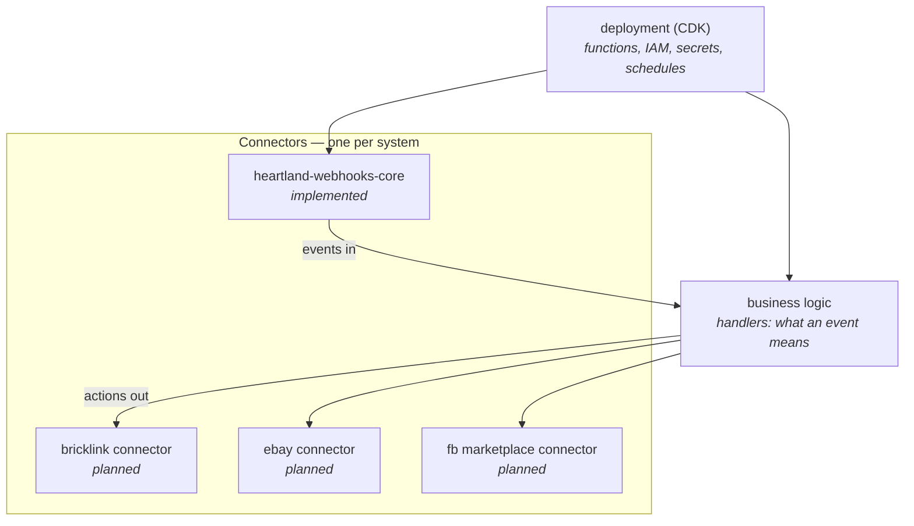

# 02 — Modules and boundaries

Clutch is an npm workspaces monorepo. Root scripts (`build`, `test`, `lint`) fan
out with `--workspaces --if-present`, so a module joins the build by declaring
those scripts and appearing in the root `workspaces` array.

## The module kinds

**Connectors own a system.** One module per connected system, covering both
directions: that system's API client, its event ingestion, and its outbound
actions ([ADR-0004](adr/0004-one-module-per-system.md)). A connector knows its
system deeply and knows nothing about any other system.

**Business logic owns meaning.** Handlers decide what a Heartland sale implies
for a BrickLink lot. This is the only layer that sees more than one system at
once, and it is where every cross-system rule lives.

**Deployment owns the runtime.** Function URLs, IAM, secret storage, log
retention, schedules — and the real `getToken` implementations. Keeping it a
separate module is what lets every other module run in tests with no AWS.

## Why connectors don't call each other

A connector that talked to another connector would make the ecosystem a mesh:
connecting the fifth system would mean touching four existing modules. Routing
lives in business logic instead, so adding a system is additive — a new
connector plus the handler rules that use it.

The corollary is that **a connector must never contain a cross-system rule.**
"When stock drops below three, delist on BrickLink but keep the eBay listing" is
business logic, even though every noun in it is BrickLink's and eBay's. The
pressure test: would a *different* store with different policy want this exact
behaviour? If no, it is not connector code.

## What transport and business logic each own

The split that `heartland-webhooks-core` already implements, and that every
later connector repeats:

| Transport (connector) | Business logic (handler) |
| --- | --- |
| Receiving and authenticating a request | What the event means |
| Attributing it to a tenant | Which systems to act on |
| Parsing and normalizing the payload | Any policy, threshold, or filter |
| Building the system client for that tenant | Composing calls to that client |
| Containing failures, shaping the response | Reporting domain results |

See [ADR-0002](adr/0002-transport-business-logic-split.md) for why, and
[`heartland-webhooks-core/design/`](../heartland-webhooks-core/design/) for the
worked version.

## Where design records live

Each module documents itself in its own `design/` folder. This top-level record
covers the ecosystem, the boundaries, and system-wide decisions; it does not
restate a module's internals.

A decision belongs **here** if it constrains more than one module — the system
of record, sync direction, what a connector may own, the invariants in
[03](03-invariants.md). It belongs in a **module's** record if changing it only
changes that module.

## Adding a module

1. Decide its kind: connector, business logic, or deployment. A module that is
   none of those three is a boundary change — write an ADR here first.
2. Add the workspace: a `package.json` with `build`, `test`, `lint`, plus the
   root `workspaces` entry.
3. Honor [03 — Invariants](03-invariants.md). Multi-tenancy by construction is
   the one most easily lost.
4. Start its `design/` folder with a README stating what the module owns and
   what it deliberately does not.
5. Depend on other modules through their published entrypoint only — never a
   deep import into another module's `src/`.

## Scheduled work has no home yet

The jobs coming from `OperationalHooks` (`undersold-items`,
`receive-open-orders`) and the reconciliation sweeps that inventory replication
needs are cron-driven: no request, no body, nothing to attribute a tenant
*from*. A scheduled job runs for every tenant, or for one named in its own
configuration.

`heartland-webhooks-core`'s webhook lifecycle does not fit them, though its
tenancy layer does — a scheduled runner should iterate `TenantRegistry` and
resolve each context directly. Which module owns that runner is undecided; see
[05 — Open questions](05-open-questions.md).
