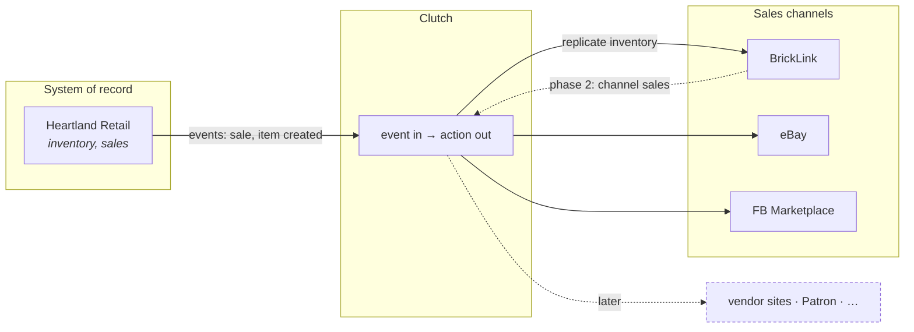

# Clutch — Design

**Clutch joins the systems of the Bricks & Minifigs ecosystem to each other.**
It reacts to an event in one system and takes automated action in the others.

This is the top-level design record: the ecosystem, the module boundaries, the
rules every module honors, and the order we're building in. It stays at that
altitude deliberately — **each module documents itself** in its own `design/`
folder, and this one does not repeat them.

| Document | What it answers |
| --- | --- |
| [01 — Ecosystem](01-ecosystem.md) | The systems, their roles, and what flows between them |
| [02 — Modules and boundaries](02-modules.md) | What the modules are, what each owns, how a new one is added |
| [03 — Invariants](03-invariants.md) | The rules every module must honor |
| [04 — Roadmap](04-roadmap.md) | What we're building in what order, and why that order |
| [05 — Open questions](05-open-questions.md) | System-level gaps and decisions not yet made |
| [ADRs](adr/) | System-wide decisions, one per file |

## The shape of it

Every connected system is an **event source**, an **action target**, or both.
Clutch's job is the arrow in the middle: notice something happened in one place,
decide what that means elsewhere, and do it — per store, with that store's
credentials.

The first class of work is **inventory replication**: what Heartland says is in
stock should be what each sales channel is offering. Heartland is the system of
record ([ADR-0001](adr/0001-heartland-system-of-record.md)); channels are
replicas of it.

## Three things to know before reading further

**It is multi-tenant, and the tenants are other Bricks & Minifigs stores.**
Clutch serves several BAM stores from one deployment. Each store has its own
Heartland instance *and* its own accounts on each channel, so "which store"
qualifies every event, every credential, and every action. Tenancy arrives as an
argument, never from ambient configuration ([03 — Invariants](03-invariants.md)).

**It assumes the BAM item schema.** Because corporate mandates a set of Heartland
custom fields for all its stores, Clutch can rely on items carrying product
meaning — department, theme, catalog ids — and not just a quantity. It is
deliberately not generic across retailers
([ADR-0005](adr/0005-assume-bam-item-schema.md)).

**It is one-way today.** Phase 1 pushes Heartland outward. Two-way — a BrickLink
sale decrementing Heartland and the other channels — is the known destination,
and the boundaries are designed for it, but nothing consumes channel events yet
([ADR-0003](adr/0003-one-way-now-two-way-destination.md)).

## Module design records

| Module | Design | Status |
| --- | --- | --- |
| [`heartland-webhooks-core`](../heartland-webhooks-core/design/) | Heartland event transport and REST client | Implemented |
| Business logic handlers | — | Next |
| BrickLink connector | — | Planned |
| eBay connector | — | Planned |
| FB Marketplace connector | — | Planned |
| Deployment (CDK) | — | Planned |

## Status

| | |
| --- | --- |
| Last reviewed | 2026-10-26 |
| Predecessor | `OperationalHooks` — still the deployed system |
| Phase | 1 of 2 (outbound replication) |
