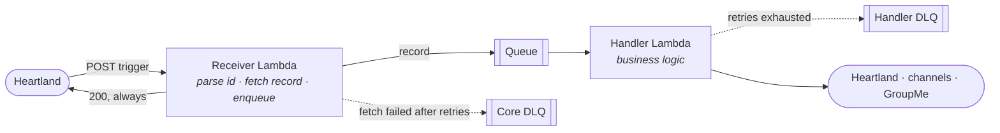

# ADR-0007 — Asynchronous processing: validate at the edge, enqueue, handle separately

**Status:** Accepted · **Date:** 2026-11-26

Closes the durable-retry gap (formerly open question 3). Supersedes the retry
half of [ADR-0007 in core](../../heartland-webhooks-core/design/adr/0007-outbound-http-timeouts-and-retries.md).

## Context

Until now a webhook was handled inline: one Lambda received the request,
resolved the tenant, parsed the body, and ran the business logic before
answering. Three problems followed from that shape.

**Work was lost on failure.** Core answers 200 unconditionally so Heartland
never disables the endpoint, which also means Heartland never redelivers. A
transient failure anywhere in the handler dropped the event permanently, with
CloudWatch as the only record. In-process retry was the only recovery available,
and it is a poor one: it has to finish inside the invocation.

**The response had to wait for the business logic.** An endpoint that answers
only after the work completes is as slow as its slowest automation, and it
couples Heartland's view of our health to a GroupMe call or a BrickLink push.

**Handler and transport shared a timeout and a concurrency budget.** A handler
doing real work needs minutes; a receiver answering a webhook needs
milliseconds. One Lambda cannot be configured for both.

## Decision

**Split receiving from handling, with a queue between them.**

**The receiver** extracts the id, fetches the authoritative record
([ADR-0006](0006-webhook-is-a-trigger-api-is-truth.md)), puts it on the queue,
and answers 200. It runs no business logic.

**The handler** is its own Lambda, consuming from the queue. It retries its own
work; when its retries are exhausted it fails the message so the message lands
in a dead-letter queue rather than being silently dropped.

**Two dead-letter queues, because there are two distinct failures:**

| DLQ | Holds | Means |
| --- | --- | --- |
| Core DLQ | the trigger — id, event type, tenant | we could not read the record. Heartland was unreachable or the fetch kept failing |
| Handler DLQ | the enqueued record | we read the record but could not act on it |

They are separated because the remedies differ: a core DLQ entry is replayed by
re-fetching, a handler DLQ entry by re-running the handler, and conflating them
would make "what do I do with this?" a per-message investigation.

**One queue to start.** Transaction and item events share it, and the handler
scales so the queue stays near empty. If one event type ever starves another,
split then — the split is an infrastructure change, not a code change.

**Core still always answers 200** ([ADR-0002 in core](../../heartland-webhooks-core/design/adr/0002-always-200.md)).
Now there is even less to say synchronously: the work has not happened yet.

**Retry budgets split, and the receiver's shrinks.** The receiver's fetch is on
the synchronous path, so its budget must stay small — an endpoint that spends
30 seconds retrying is a worse citizen than one that fails in two and lets the
DLQ hold the trigger. Durability no longer comes from retrying harder; it comes
from the queue and the DLQs. The handler, off the synchronous path, can afford a
real backoff.

## Consequences

- **Nothing is lost quietly.** Every failure ends up either retried or in a DLQ
  with the context needed to replay it. This is the gap that made "we gave up
  Heartland's retries" an expensive trade; it is now paid for.
- **Handler idempotency becomes mandatory.** Queue delivery is at-least-once, and
  a handler that fails after partially completing its writes *will* be re-run
  from the start. Combined with the replay exposure in
  [ADR-0006](0006-webhook-is-a-trigger-api-is-truth.md), this moves idempotency
  from a documented expectation to a correctness requirement — see
  [03 — Invariants](../03-invariants.md) and the still-open dedup question in
  [05 — Open questions](../05-open-questions.md).
- **`supports()` moves to the handler side.** It is handler code, and the handler
  no longer runs in the receiver, so the receiver cannot consult it. The cost is
  queue traffic for events that are ultimately ignored. If that ever matters, the
  receiver can carry a cheap declarative filter in configuration — not a copy of
  the handler's logic.
- **A handler can no longer report into the HTTP response.** `WebhookOutcome`
  results have no synchronous consumer; `details` becomes a logging concern. The
  response collapses to "accepted" or "rejected".
- **Receiver and handler are separate deployables**, so they get separate
  timeouts, memory, and concurrency — which is most of the point. It also means
  two things to deploy and keep in step, and a queue to monitor. Queue depth and
  DLQ depth become the health signals that matter.
- **The two-way phase gets much easier.** Inbound channel events need exactly
  this shape, and the queue is where they will land
  ([ADR-0003](0003-one-way-now-two-way-destination.md)).
- **Concurrency now needs thought.** Two messages for the same record can be
  processed simultaneously, each reading current state and writing back. Ordering
  is mostly self-correcting under ADR-0006, but simultaneity is not. A FIFO queue
  keyed by record id, or per-record serialization, is the lever if it bites.
- **Latency goes up** — a queue hop and a cold start between the sale and the
  action. For store automation that is irrelevant; it would matter for anything
  user-facing, and nothing here is.

## Alternatives considered

**Keep it synchronous and rely on in-process retry.** The status quo. Rejected:
retries that must finish inside a webhook response cannot be patient, and
anything they fail to fix is gone.

**Answer non-200 and let Heartland redeliver.** The conventional answer, and it
needs no queue. Rejected because Heartland disables endpoints that keep
failing — a transient outage would trade lost events for a dead endpoint. This
is ADR-0002's reasoning, unchanged.

**Enqueue the trigger and fetch the record in the handler.** Keeps the receiver
as thin as possible. Rejected: validation is the point of fetching. Doing it at
the edge means an invalid id is rejected immediately rather than discovered after
a queue hop, and a garbage trigger never occupies the queue at all.

**One DLQ for both stages.** Fewer resources. Rejected: the two failures need
different remedies, and a single queue would make every entry an investigation.

**One queue per event type, from the start.** Better isolation. Rejected for now
as premature — splitting later is an infrastructure change, and the handler is
expected to keep the queue near empty.
