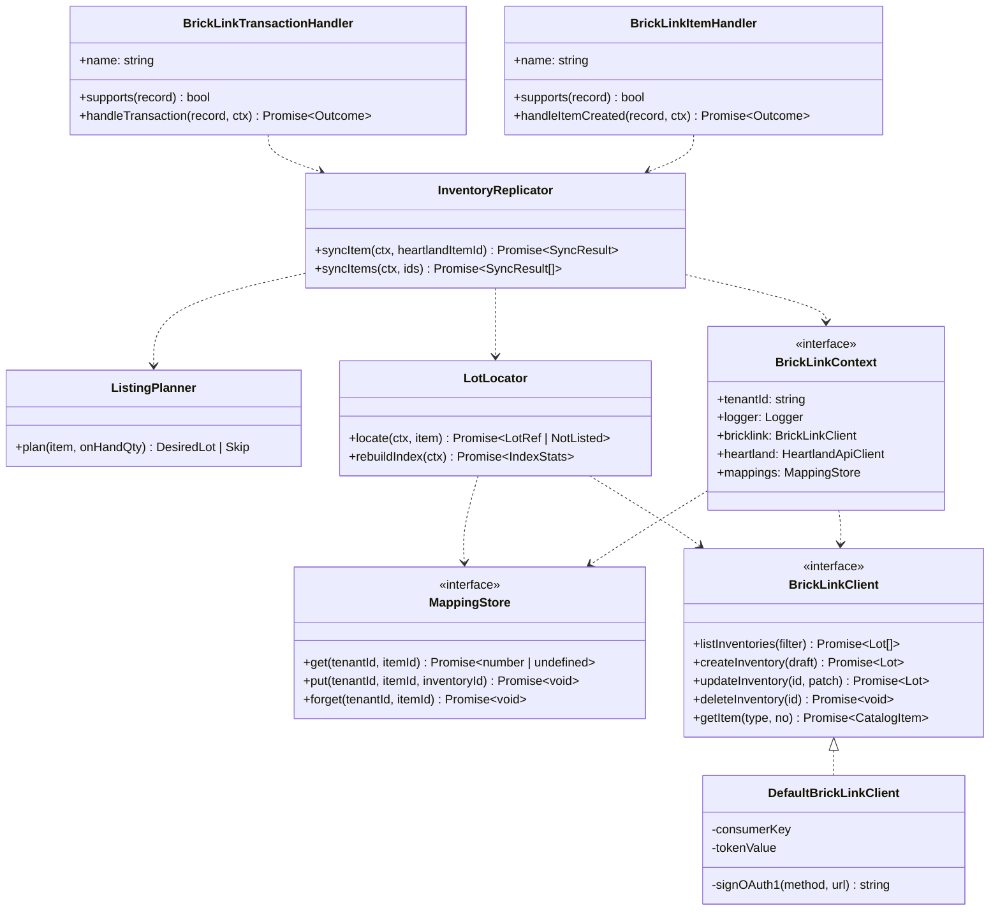
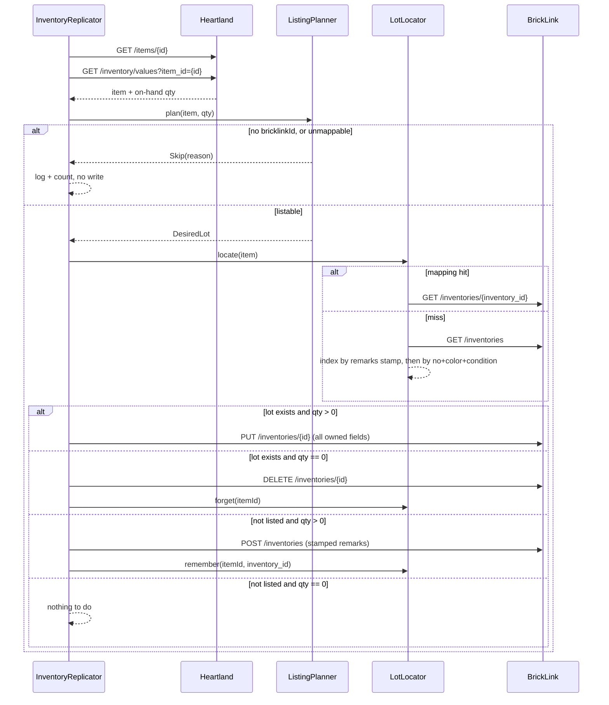
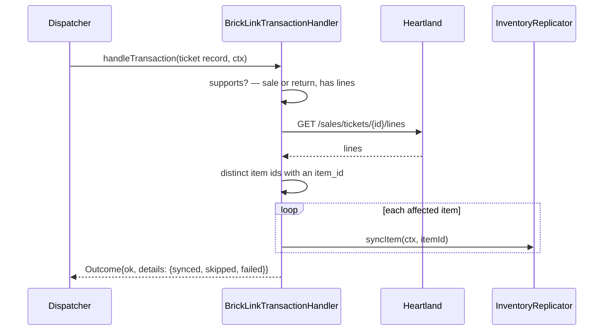
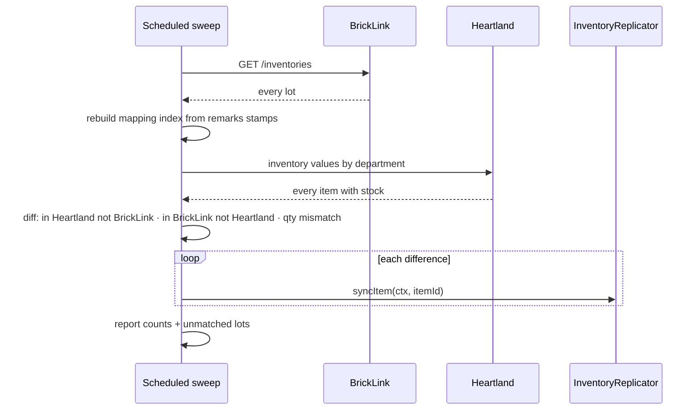

# Proposal — BrickLink inventory replication

**Status:** Proposed · **Date:** 2026-11-26 · Spans two modules, so it lives here
rather than in either one. On acceptance it splits: the client half into the
BrickLink connector's record, the business-logic half into the handler's.

Replicate Heartland inventory onto a tenant's BrickLink store: what Heartland
says is in stock should be what BrickLink is offering.

## What the API forces

Three facts about BrickLink's Store API decide most of this design.

**1. You cannot look up your own lot by item number.** `GET /inventories`
filters on `item_type`, `status`, `category_id`, and `color_id` — there is no
`item_no` filter, and the inventory resource has no external-id field. Finding
"our lot for Heartland item 10234" means either remembering its `inventory_id`
or scanning the whole inventory.

**2. The writable fields are `item.no` + `item.type` + `color_id` + `quantity` +
`unit_price` + `new_or_used` + `completeness` + `description` + `remarks`** (plus
bulk/retain/stockroom flags). `remarks` and `description` are free text we
control — the only place we can stamp our own identity.

**3. Auth is OAuth 1.0a, HMAC-SHA1.** `requestJson`'s `authorization` escape
hatch exists for exactly this; the predecessor already has working signing code
to port.

## Identity: a cache, not a system of record

The mapping from a Heartland item to a BrickLink lot is resolved in three tiers,
cheapest first:

| Tier | Mechanism | Cost |
| --- | --- | --- |
| 1 | `MappingStore` — `(tenantId, heartlandItemId) → inventory_id`. **Optional, default off** | one read |
| 2 | Inventory scan, indexed by the Heartland id stamped in `remarks`. **The primary mechanism** | one fetch of stocked lots |
| 3 | Same scan, matched on `item.no` + `color_id` + `new_or_used` | same fetch, fuzzier |

**Every lot we create carries its Heartland item id in `remarks`.** That is what
makes tier 2 possible, and it is the point of the design: the BrickLink
inventory becomes self-describing, so the mapping store is a **rebuildable
cache** rather than authoritative state. Lose it and a sweep reconstructs it.

That matters for [ADR-0008](../adr/0008-handlers-own-state-idempotency-recovery.md).
Handlers own their state, and the cheapest state to own is state you can
regenerate — no backup story, no migration story, and a corrupted entry is
self-healing.

Tier 3 exists because lots created by hand, before Clutch or beside it, will not
carry a stamp. It is a heuristic and can mis-match; it should log loudly and
never silently overwrite a lot it is not sure about.

## Catalog translation

`ListingPlanner`'s whole job, and now specified. Everything keys off
`custom.sub_department` — the field the item parser already reads as
`subDepartment`.

| `sub_department` | `item.type` | `new_or_used` | `completeness` |
| --- | --- | --- | --- |
| New In Box | SET | `N` | `S` sealed |
| Retired New In Box | SET | `N` | `S` sealed |
| Certified Used Set | SET | `U` | `C` complete |
| Used Set | SET | `U` | `C` if pre-built, else `B` incomplete |
| Collectible Minifig | MINIFIG | `U` | — not applicable |
| Casefig | MINIFIG | `U` | — not applicable |
| **anything else** | — | — | **not listed** |

**Pre-built comes from `custom.bam_category`**, not from the sub-department.
Confirmed against a real used set (`75317-1`):

```json
"custom": {
  "tags": "BrickHeadz,Used Set,Pre-Built Set,add",
  "department": "Used Sets",
  "sub_department": "Used Set",
  "bam_category": "Pre-Built Set",
  "bricklink_id": "75317-1",
  "upc": ""
}
```

So the one conditional row reads: `sub_department` is *Used Set* **and**
`bam_category` is *Pre-Built Set* → `C`, otherwise `B`. Note `tags` carries the
same two facts as free text; the typed custom fields are the ones to read, not
the tag string.

**Match on a normalized value — trimmed and case-folded — against this table,
and treat an unmapped value as a counted, logged skip.** Spelling then stops
being load-bearing, and a sub-department nobody mentioned shows up as a rising
skip count instead of silence. Worth knowing the real values differ in number:
the *department* is "Used Sets" while the *sub-department* is "Used Set".

### `bricklink_id` is the catalog number, and it is already right

`bricklink_id` on that item is `75317-1` — exactly BrickLink's `item.no` format
for a set. It goes straight into `item.no` with no transformation, which is the
whole reason catalog identity needs no mapping store.

It also happens to equal `public_id` on this item. **Do not rely on that.** One
item is not a convention, and if BAM's SKU and the BrickLink number diverge
anywhere, `bricklink_id` is the field that is *meant* to carry it.

### Listability preconditions, from the real record

The sub-department table decides *how* to list. These decide *whether* to:

| Condition | Why |
| --- | --- |
| `active?` is true | an inactive item should not be on sale |
| `track_inventory?` is true | without tracking there is no on-hand figure to replicate. `BAM10000` (Bulk Loose Pieces) has it false |
| `prompt_for_price?` is false **and** `price > 0` | a prompt-for-price item has no price to publish. `BAM10000` has `price: 0` and prompts |
| `bricklink_id` is non-empty | nothing to list against |
| `sub_department` maps in the table above | everything else is filtered out |

**Empty string is the absent case, not `undefined`.** `upc` on that item is
`""`, and `BAM10000`'s `custom` object omits `sub_department`, `bam_category`
and `bricklink_id` entirely. So a field is present only if it is non-empty after
trimming — two different shapes of missing, one check. This is
[ADR-0005](../adr/0005-assume-bam-item-schema.md)'s "mandated does not mean
populated" showing up in the first two items we looked at.

Two corrections the API forces on the rule as stated:

- **`completeness` is SET-only** (values `C`, `B`, `S`). So "collectible minifig
  and casefig are used and complete" becomes `new_or_used: U` with completeness
  omitted — there is no field to carry "complete" for a minifig.
- **Confirm `completeness: S` is accepted alongside `new_or_used: N`** on the
  first create. Sealed is meaningful for a new set, but the docs describe
  completeness as complete-or-incomplete, so this is worth proving rather than
  assuming.

### Quantity, and a thing the live data shows

```
quantity = max(0, onHand)
```

Not a defensive flourish. Pulling real inventory by department turned up
negative on-hand in several of them — Bulk at −5899, Parties/Events at −89,
Convenience at −9 — and the predecessor carries an
`inventory-non-negative-strategy`, so negative stock is a known condition rather
than a glitch.

A negative quantity must never reach BrickLink. Clamp to zero, which means "not
listed", and **count it separately from a legitimate zero** — the two look
identical on the channel and mean very different things in the store.

None of those departments list under the sub-department table above, so this is
belt-and-braces today. It stops being belt-and-braces the moment a listable
sub-department goes negative.

## Module split

The connector owns BrickLink; the handler owns what a Heartland event means for
it ([ADR-0004](../adr/0004-one-module-per-system.md),
[ADR-0002](../adr/0002-transport-business-logic-split.md)).



Why these seams:

- **`ListingPlanner` is pure.** Heartland item + on-hand quantity in, a desired
  lot or a reason to skip out. No I/O, so every catalog-translation and
  BAM-schema rule is unit-testable without a network or a fake store. This is
  where `bricklinkId`, condition, and price mapping live.
- **`InventoryReplicator` is the only thing that writes.** Both handlers are
  thin adapters over `syncItem`, so "what it means to be in sync" has one
  implementation, shared with the sweep.
- **`LotLocator` hides the three tiers**, so callers never think about the cache.
- **`BrickLinkContext` declares exactly two systems and a store** — not a context
  holding every client ([ADR-0009](../adr/0009-handler-specific-contexts.md)).
  It needs `heartland` because a sale tells it *which* items changed, not what
  they now are.

## Sync one item

The unit of work. Set, never adjust — which is what makes it idempotent under
redelivery and replay.



## A sale



The handler does **not** compute the new quantity from the sale. It re-reads
Heartland's on-hand figure per item and pushes that. A delta would be wrong the
moment a message is redelivered or two sales of the same item are processed at
once; re-reading is correct under both, and it is the concrete form of "set, not
adjust".

A partial failure fails the message so it retries and eventually reaches the
handler DLQ — which is safe precisely because every step is idempotent.

## The sweep



**The sweep is not optional for BrickLink, and this is the part worth arguing
with.** Heartland emits `sales_transaction_completed` and `item_created`.
Nothing tells us about **receiving stock, manual adjustments, transfers, or
price changes** — so a lot whose quantity changed for any of those reasons stays
wrong until a sweep notices. Event-driven replication covers sales and new
items; everything else is sweep territory. That makes the scheduled-work
decision ([#21](https://github.com/bamherndon/Clutch/issues/21)) a dependency of
BrickLink going live, not a follow-up.

## The eight handler responsibilities

Answering [06 — Handler responsibilities](../06-handler-responsibilities.md),
since a design that skips these is incomplete by definition.

| # | Concern | Answer |
| --- | --- | --- |
| 1 | **Idempotency** | Every write sets absolute state from Heartland. Re-running `syncItem` is a no-op. Creating a lot is the one non-idempotent act, guarded by `locate()` running first — and a double-create is recoverable: the sweep finds two stamped lots and merges. |
| 2 | **State** | `MappingStore`, keyed `(tenantId, heartlandItemId)`. A rebuildable cache, not truth. Tenant in the key, always. |
| 3 | **Concurrency** | Two sales of one item can be in flight together, and both do read-then-write. Both read current Heartland truth, so the loser writes the same value — benign. The real race is two creates for an unlisted item; mitigation is `locate()` immediately before create, accepting that the sweep cleans up the rare duplicate. |
| 4 | **Failure and recovery** | Per-item failures are collected, not thrown, so one bad item does not abandon the rest of a ticket; the handler then fails the message if any item failed. A DLQ entry means "re-run this ticket" and is always safe to replay. |
| 5 | **Rate limits** | BrickLink documents a daily request cap — **confirm the current number**. A full-inventory fetch is one call; per-item syncs are 2 Heartland + 1–2 BrickLink. The sweep is the thing most likely to exhaust a daily budget, so it needs a ceiling and the ability to resume. |
| 6 | **Context** | `tenantId`, `logger`, `bricklink`, `heartland`, `mappings`. Two systems because a sale names items but does not describe them. |
| 7 | **Observability** | Per run: items synced, created, updated, deleted, skipped-with-reason, failed. Skips are the interesting number — a rising "no bricklinkId" count is a data-quality signal, and it must not look like silence. |
| 8 | **Data assumptions** | Requires `bricklinkId` on an item to list it at all; missing is a per-item data problem, reported and skipped ([ADR-0005](../adr/0005-assume-bam-item-schema.md)). |

## Policy decisions

All four settled.

| # | Decision |
| --- | --- |
| 1 | **Heartland is the source of truth for every field.** Clutch sets `quantity`, `unit_price`, `description` and `remarks` on every write. A hand edit on BrickLink does not survive the next sync. |
| 2 | **Zero stock deletes the lot**, and it is re-created when stock returns. The inventory is wide but sparse — most items are out of stock most of the time — so zero-quantity lots would dominate the store. |
| 3 | **Create on first positive stock**, not on `item_created`. The `item_created` handler still does a validation-only pass: resolve `bricklink_id` against BrickLink's catalog and report a skip if it does not exist, so a bad id surfaces before a sale depends on it. |
| 4 | **On-hand is the sum across a tenant's configured locations**, one or more, stated in configuration. Never a sum across all locations — that would publish parts-out or staging stock as sellable. |

Also settled: a casefig is a MINIFIG to BrickLink, so the translation table
stands.

### What "delete on zero" changes

It is the right call for a sparse inventory, and it moves the design in three
ways worth stating.

**The hot path becomes create and delete, not update.** A wide, sparse inventory
means most stock transitions cross zero: an item sells out and the lot goes
away; a box is received and the lot comes back. Updates happen only between
those. So the write the design must be most careful about is the one that is not
naturally idempotent — `create` — and `locate()` immediately before create stops
being a nicety.

**The persistent mapping store loses most of its value.** A stored
`inventory_id` is valid only while the lot exists, and under this policy lots are
deleted routinely — so most cached entries are stale most of the time. Two
consequences:

- `forget()` on every delete is mandatory, not housekeeping. A stale id pointed
  at a deleted lot produces a 404 on update, which must be treated as
  "not listed" and fall through to create rather than failing the item.
- The sparse inventory makes the alternative cheap: `GET /inventories` returns
  only *stocked* lots, which is a small fraction of the catalog. So the stamp
  scan is a modest call, and a per-process index with a short TTL — keyed by
  tenant — covers the warm case.

**Recommendation: make `MappingStore` optional and default to off.** Resolve by
stamp scan with a warm in-process index, and add the persistent store only if
the stocked-lot count grows enough to make the scan hurt. That removes the only
piece of durable state from this handler, which is the cheapest possible answer
to [ADR-0008](../adr/0008-handlers-own-state-idempotency-recovery.md) — nothing
to provision, nothing to lose, nothing to migrate.

**Idempotency still holds.** Redelivery after a delete re-reads Heartland, still
sees zero, finds no lot, does nothing. Redelivery after a create finds the lot by
its stamp and updates it. The race that remains is a zeroing and a restocking
message in flight together, which can briefly leave the channel wrong in either
direction; both self-heal on the next event for that item or on the sweep.

### The phase-1 interaction this makes concrete

Set-semantics plus Heartland-as-truth means **Clutch will actively undo
BrickLink's own decrements.** A BrickLink buyer purchases a lot, BrickLink
reduces its quantity, and the next sync sets it straight back to Heartland's
figure — which still counts the sold item, because Heartland does not learn
about a BrickLink sale until staff ring it up.

That is the known one-way gap ([ADR-0003](../adr/0003-one-way-now-two-way-destination.md)),
but it is worth seeing in its concrete form: replication does not merely fail to
prevent overselling, it can **restore** oversold quantities. Two mitigations
until phase 2, both operational rather than technical:

- BrickLink sales get entered in Heartland promptly, and "promptly" now has a
  definition: before the next sync touches that item.
- The sweep's correction direction is Heartland → BrickLink, so a sweep will do
  the same thing. It is not a safety net for this.

This is the strongest argument for phase 2 that the design has produced so far,
and it belongs in the decision to go live with a BrickLink store.

## Open risks

- **Tier-3 matching can mis-identify a hand-made lot.** It must refuse
  ambiguous matches rather than guess, and say so in the log.
- **A full-inventory fetch is the hot spot.** If an inventory grows into the
  thousands of lots, per-event tier-2 fallback becomes too expensive and the
  mapping store stops being optional.
- **`remarks` may already be in use** for storage location or similar. If so,
  the stamp needs a delimited convention rather than owning the field — check
  before designing around it.
