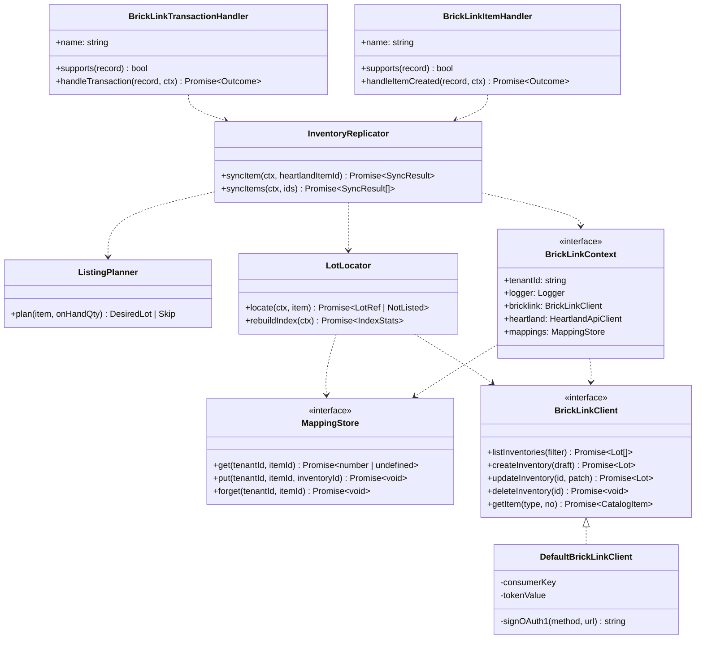
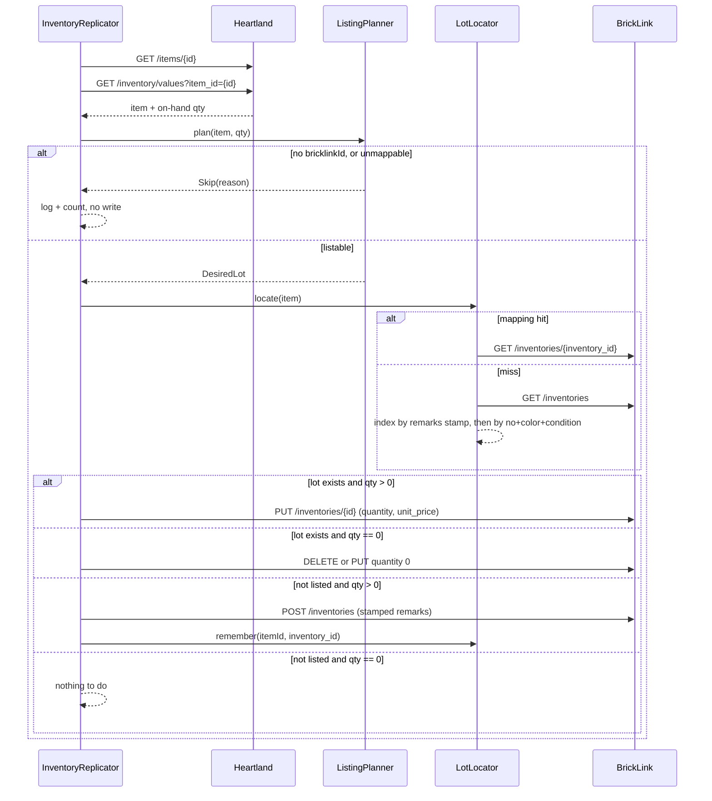
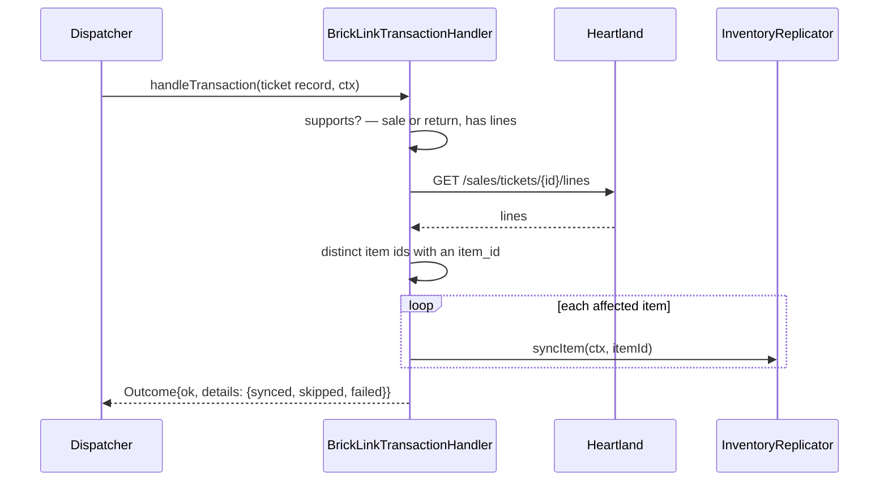
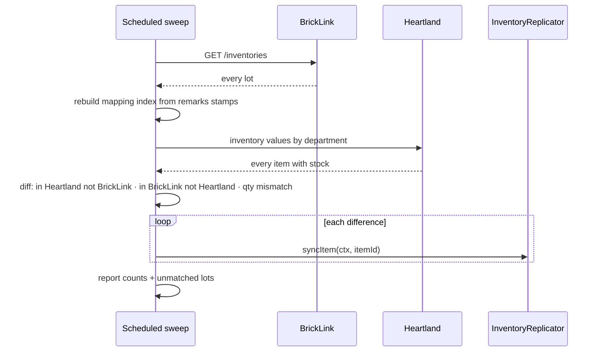

# Proposal — BrickLink inventory replication

**Status:** Proposed · **Date:** 2026-11-26 · Spans two modules, so it lives here
rather than in either one. On acceptance it splits: the client half into the
BrickLink connector's record, the business-logic half into the handler's.

Replicate Heartland inventory onto a tenant's BrickLink store: what Heartland
says is in stock should be what BrickLink is offering.

## What the API forces

Three facts about BrickLink's Store API decide most of this design.

**1. You cannot look up your own lot by item number.** `GET /inventories`
filters on `item_type`, `status`, `category_id`, and `color_id` — there is no
`item_no` filter, and the inventory resource has no external-id field. Finding
"our lot for Heartland item 10234" means either remembering its `inventory_id`
or scanning the whole inventory.

**2. The writable fields are `item.no` + `item.type` + `color_id` + `quantity` +
`unit_price` + `new_or_used` + `completeness` + `description` + `remarks`** (plus
bulk/retain/stockroom flags). `remarks` and `description` are free text we
control — the only place we can stamp our own identity.

**3. Auth is OAuth 1.0a, HMAC-SHA1.** `requestJson`'s `authorization` escape
hatch exists for exactly this; the predecessor already has working signing code
to port.

## Identity: a cache, not a system of record

The mapping from a Heartland item to a BrickLink lot is resolved in three tiers,
cheapest first:

| Tier | Mechanism | Cost |
| --- | --- | --- |
| 1 | `MappingStore` — `(tenantId, heartlandItemId) → inventory_id` | one read |
| 2 | Full-inventory scan, indexed by the Heartland id stamped in `remarks` | one large fetch |
| 3 | Full-inventory scan, matched on `item.no` + `color_id` + `new_or_used` | same fetch, fuzzier |

**Every lot we create carries its Heartland item id in `remarks`.** That is what
makes tier 2 possible, and it is the point of the design: the BrickLink
inventory becomes self-describing, so the mapping store is a **rebuildable
cache** rather than authoritative state. Lose it and a sweep reconstructs it.

That matters for [ADR-0008](../adr/0008-handlers-own-state-idempotency-recovery.md).
Handlers own their state, and the cheapest state to own is state you can
regenerate — no backup story, no migration story, and a corrupted entry is
self-healing.

Tier 3 exists because lots created by hand, before Clutch or beside it, will not
carry a stamp. It is a heuristic and can mis-match; it should log loudly and
never silently overwrite a lot it is not sure about.

## Module split

The connector owns BrickLink; the handler owns what a Heartland event means for
it ([ADR-0004](../adr/0004-one-module-per-system.md),
[ADR-0002](../adr/0002-transport-business-logic-split.md)).

Why these seams:

- **`ListingPlanner` is pure.** Heartland item + on-hand quantity in, a desired
  lot or a reason to skip out. No I/O, so every catalog-translation and
  BAM-schema rule is unit-testable without a network or a fake store. This is
  where `bricklinkId`, condition, and price mapping live.
- **`InventoryReplicator` is the only thing that writes.** Both handlers are
  thin adapters over `syncItem`, so "what it means to be in sync" has one
  implementation, shared with the sweep.
- **`LotLocator` hides the three tiers**, so callers never think about the cache.
- **`BrickLinkContext` declares exactly two systems and a store** — not a context
  holding every client ([ADR-0009](../adr/0009-handler-specific-contexts.md)).
  It needs `heartland` because a sale tells it *which* items changed, not what
  they now are.

## Sync one item

The unit of work. Set, never adjust — which is what makes it idempotent under
redelivery and replay.

## A sale

The handler does **not** compute the new quantity from the sale. It re-reads
Heartland's on-hand figure per item and pushes that. A delta would be wrong the
moment a message is redelivered or two sales of the same item are processed at
once; re-reading is correct under both, and it is the concrete form of "set, not
adjust".

A partial failure fails the message so it retries and eventually reaches the
handler DLQ — which is safe precisely because every step is idempotent.

## The sweep

**The sweep is not optional for BrickLink, and this is the part worth arguing
with.** Heartland emits `sales_transaction_completed` and `item_created`.
Nothing tells us about **receiving stock, manual adjustments, transfers, or
price changes** — so a lot whose quantity changed for any of those reasons stays
wrong until a sweep notices. Event-driven replication covers sales and new
items; everything else is sweep territory. That makes the scheduled-work
decision ([#21](https://github.com/bamherndon/Clutch/issues/21)) a dependency of
BrickLink going live, not a follow-up.

## The eight handler responsibilities

Answering [06 — Handler responsibilities](../06-handler-responsibilities.md),
since a design that skips these is incomplete by definition.

| # | Concern | Answer |
| --- | --- | --- |
| 1 | **Idempotency** | Every write sets absolute state from Heartland. Re-running `syncItem` is a no-op. Creating a lot is the one non-idempotent act, guarded by `locate()` running first — and a double-create is recoverable: the sweep finds two stamped lots and merges. |
| 2 | **State** | `MappingStore`, keyed `(tenantId, heartlandItemId)`. A rebuildable cache, not truth. Tenant in the key, always. |
| 3 | **Concurrency** | Two sales of one item can be in flight together, and both do read-then-write. Both read current Heartland truth, so the loser writes the same value — benign. The real race is two creates for an unlisted item; mitigation is `locate()` immediately before create, accepting that the sweep cleans up the rare duplicate. |
| 4 | **Failure and recovery** | Per-item failures are collected, not thrown, so one bad item does not abandon the rest of a ticket; the handler then fails the message if any item failed. A DLQ entry means "re-run this ticket" and is always safe to replay. |
| 5 | **Rate limits** | BrickLink documents a daily request cap — **confirm the current number**. A full-inventory fetch is one call; per-item syncs are 2 Heartland + 1–2 BrickLink. The sweep is the thing most likely to exhaust a daily budget, so it needs a ceiling and the ability to resume. |
| 6 | **Context** | `tenantId`, `logger`, `bricklink`, `heartland`, `mappings`. Two systems because a sale names items but does not describe them. |
| 7 | **Observability** | Per run: items synced, created, updated, deleted, skipped-with-reason, failed. Skips are the interesting number — a rising "no bricklinkId" count is a data-quality signal, and it must not look like silence. |
| 8 | **Data assumptions** | Requires `bricklinkId` on an item to list it at all; missing is a per-item data problem, reported and skipped ([ADR-0005](../adr/0005-assume-bam-item-schema.md)). |

## What I need from you

These are store-policy and data questions, not technical ones, and the design is
blocked on them in the places noted.

1. **Condition.** `new_or_used` is required on every lot, and I see no Heartland
   custom field carrying it. Does it come from `department` / `subDepartment`,
   from `bamCategory`, or somewhere else? `ListingPlanner` cannot be written
   without this.
2. **Completeness.** Used sets need `completeness` (complete / incomplete /
   sealed). Same question — where does it live in Heartland?
3. **Which fields do we own?** Quantity, certainly. Price? Description? If
   Clutch owns `unit_price`, nobody can price-adjust on BrickLink by hand
   without being overwritten. This is [#24](https://github.com/bamherndon/Clutch/issues/24).
4. **Zero stock.** Delete the lot, or keep it at quantity 0? Also needs
   verifying whether BrickLink auto-removes a lot at zero.
5. **Creating listings.** Should `item_created` publish a listing immediately
   (quantity 0 until stock arrives), or should a listing appear only when stock
   first exists? The second is less chatty; the first makes the catalog mapping
   fail early and visibly.
6. **Multi-location.** `GET /inventory/values` groups by item **and location**.
   Is a tenant's BrickLink stock one location's on-hand, or the sum?
7. **Item types.** Sets and minifigs presumably, with `color_id` 0. Do we ever
   list parts, where colour is load-bearing?

## Open risks

- **Tier-3 matching can mis-identify a hand-made lot.** It must refuse
  ambiguous matches rather than guess, and say so in the log.
- **A full-inventory fetch is the hot spot.** If an inventory grows into the
  thousands of lots, per-event tier-2 fallback becomes too expensive and the
  mapping store stops being optional.
- **`remarks` may already be in use** for storage location or similar. If so,
  the stamp needs a delimited convention rather than owning the field — check
  before designing around it.
