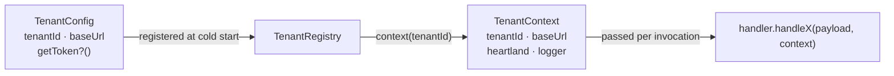

# 01 — Multi-tenancy

A tenant is one Heartland Retail instance: its own base URL, its own API token,
its own data. One Clutch deployment serves several, and the tenancy layer is the
part of core that makes that true.

"Tenant-agnostic" here means **agnostic across Bricks & Minifigs stores** — all
of which share a corporate-mandated item schema — not across retailers in
general. See [ADR-0005](../../design/adr/0005-assume-bam-item-schema.md).

The constraint that shaped it, recorded in `src/tenancy/tenant.ts`: the previous
single-tenant design read configuration from `process.env`, which made running
two Heartland instances from one deployment impossible. Everything here exists
to keep tenant-varying values out of ambient state.

## The three types



**`TenantConfig`** — what a deployment declares, and **configuration only**: it
carries no business logic. Declarative and cheap to construct, because
`getToken` is a *function* rather than a value, so registering twenty tenants
does not load twenty secrets at cold start.

**`TenantContext`** — what a handler receives per invocation: the tenant id, the
base URL, a Heartland client already bound to that tenant's credentials, and a
logger already tagged with the tenant id. A handler that takes everything
tenant-varying from here is automatically multi-tenant-safe.

**`TenantRegistry`** — owns the configs and builds contexts on demand. It knows
nothing about handlers; it maps a tenant id to a context and stops there.

## One handler, many tenants

A handler is **declared once, at the factory, not per tenant**:

```ts
createTransactionLambda({
  handler: new BamTransactionHandler({ groupMe }),   // one instance, all tenants
  tenants: [
    { tenantId: 'bamherndon', baseUrl: urlA, getToken: tokenA },
    { tenantId: 'bamreston',  baseUrl: urlB, getToken: tokenB },
  ],
  resolveTenant: fromPathSegment(0),
});
```

This is structural, not a convention to remember. There is no handler field on
`TenantConfig` and no handler map anywhere in the package, so a per-tenant
handler is not something a deployment can express by accident. Everything that
varies between stores arrives as the `TenantContext` argument on each
invocation, which leaves nowhere for per-store state to hide.

The consequence for handler authors: a handler must hold no per-tenant state.
Constructor dependencies are for things that are the same for every tenant — a
shared outbound client, a feature flag. Anything that differs per store comes
from the context. A handler that *wants* its own instance per tenant is holding
state it should be reading from the context instead.

If two stores genuinely need different behaviour, that is a branch inside one
handler (on `context.tenantId`, or on data), or a separate deployment — not two
instances wired into one lambda.

## Lazy, memoized, failure-transparent

`TenantRegistry.context()` is the interesting method. Three properties, in
priority order:

1. **Lazy.** A tenant's token is loaded on its first webhook, not at cold start.
   A deployment serving many tenants pays for only the ones that are active.
2. **Memoized for the process lifetime.** The *promise* is cached, not the
   resolved value, so two concurrent invocations for the same tenant share one
   token load rather than racing. A warm Lambda loads each token exactly once.
3. **Failures are not cached.** The `.catch()` deletes the cache entry and
   rethrows. A transient Secrets Manager error fails one webhook; it does not
   poison that tenant until the next cold start. This is the subtle one, and it
   is the reason the cache holds a promise with a `catch` rather than a plain
   memoized value.

An empty token is treated as a failure, not as a valid credential — a blank
secret otherwise produces a confusing cascade of 401s from Heartland instead of
one clear error at the boundary.

Duplicate `tenantId`s throw from the constructor. Cold-start-time failure for a
configuration mistake is the right trade: the alternative is one tenant silently
shadowing another.

## Tenants without credentials

`getToken` is **optional**. It exists only so core can build the authenticated
client exposed as `TenantContext.heartland`; a handler never sees a token. A
tenant whose handler only reads the webhook payload and never calls Heartland
back therefore needs no credentials, and none are ever fetched for it.

Omitting it does not yield a context with a missing client, because an
`undefined` there would fail at the first call site with a type error or a
`TypeError` far from the cause. Instead the context carries a stand-in whose
every method rejects:

```
Tenant "bamreston" has no getToken configured, so getTicketLines() cannot call the Heartland API
```

One log line names both the tenant and the method, which is enough to identify
the misconfiguration without a stack trace.

The stand-in is a `Proxy`, and it deliberately refuses `then`, `catch`,
`finally`, and symbol properties. A `Proxy` that answers `then` is a *thenable*:
`await`ing it would try to resolve it as a promise and hang instead of yielding
the client. That is a real bug that was caught in review, and
`tests/tenancy/registry.test.ts` pins it.

## Resolving a tenant from a request

```ts
export type TenantResolver = (event: APIGatewayProxyEventV2) => TenantId | undefined;
```

Returning `undefined` means "I cannot tell", which is what makes resolvers
composable rather than exclusive.

| Resolver | Reads | Use when |
| --- | --- | --- |
| `fromPathSegment(index = 0)` | path segments of `rawPath` | **The default for Lambda Function URLs** |
| `fromPathParameter(name = 'tenantId')` | `event.pathParameters` | Fronted by an API Gateway route such as `/{tenantId}/transaction` |
| `fromHeader(name = 'x-clutch-tenant')` | headers, case-insensitively | Heartland can be configured to send a custom header |
| `fromQueryString(name = 'tenant')` | `event.queryStringParameters` | Last resort; visible in logs and easy to forget |
| `fixedTenant(id)` | nothing | Single-tenant deployments and tests |
| `firstOf(...resolvers)` | each in turn | Migrating between schemes; first non-empty answer wins |

`fromPathSegment` is the default for a specific reason: Lambda Function URLs
have no route templates, so `pathParameters` is never populated. Each tenant
registers its webhook in Heartland against its own path —
`https://<fn-url>/bamherndon/transaction` — and index `0` picks the tenant off
the front.

The request-reading resolvers trim their input and treat an empty string as
`undefined`. `fixedTenant` returns its argument verbatim, and `firstOf`
delegates, so neither normalizes anything itself.

Whether Heartland actually permits a per-tenant path on a registered webhook URL
is **unconfirmed** — it is to be settled in testing. If it does not, switching to
`fromHeader` or `fromQueryString` is a change in the calling module's wiring and
not a change to core. The case that would need a small core change is a tenant
discriminator available only inside the payload, since a resolver runs before
the body is parsed; see [06 — Open questions](06-open-questions.md).

## Single-tenant deployments

`registry.soleTenantId` returns the only id when exactly one tenant is
registered, and the pipeline falls back to it when no resolver is given. So the
simple case stays simple:

```ts
export const handler = createTransactionLambda({
  handler: new BamTransactionHandler(),
  tenants: [{ tenantId: 'bamherndon', baseUrl, getToken }],
});
```

The moment a second tenant is registered without a `resolveTenant`,
`createWebhookLambda` throws at construction — at cold start, listing the
registered tenant ids. The failure mode that must never happen is one store's
webhooks being handled with another store's credentials, so the check is
structural rather than a runtime guess. Registering zero tenants throws for the
same reason.

## Tenant isolation guarantees

What the design guarantees today:

- Each tenant's Heartland client holds only that tenant's base URL and token;
  clients are constructed per tenant and never shared.
- Every log line emitted through a context's logger carries the tenant tag, so
  CloudWatch can be filtered to one store.
- A handler never sees a credential. Tokens exist so core can build that
  tenant's client; `TenantContext` exposes the client, not the token.
- A handler cannot reach another tenant's client, because the only client it is
  given is the one on the context it was invoked with.

What it does not guarantee:

- **No request authentication.** Core does not verify that a request claiming to
  be `bamherndon` actually came from that store's Heartland instance. Today
  tenant ids are treated as routing keys, not credentials. See
  [06 — Open questions](06-open-questions.md).
- **No per-tenant rate or cost isolation.** All tenants share one Lambda's
  concurrency.

## Related

- [ADR-0003 — Lazy, memoized tenant contexts](adr/0003-lazy-memoized-tenant-contexts.md)
- [ADR-0005 — Injected token loading](adr/0005-injected-token-loading.md)
- [02 — Webhook pipeline](02-webhook-pipeline.md) for where resolution sits in the lifecycle
