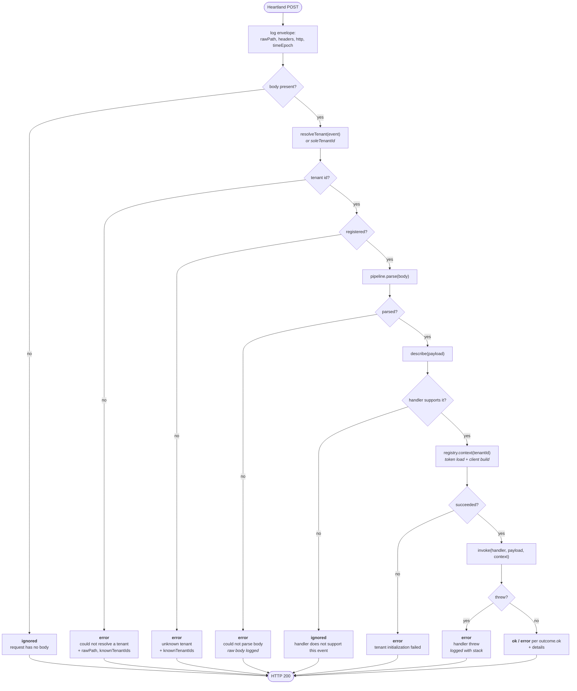

# 02 — Webhook pipeline

`src/lambda/pipeline.ts` holds the entire lifecycle of an inbound webhook. It is
the most load-bearing file in the package: every ordering decision and every
error-containment rule lives there, once, for both event types.

## The `WebhookPipeline` seam

`createWebhookLambda` is generic over payload and handler type. Everything that
differs between the two webhooks is supplied as a small record:

| Field | Transaction lambda | Item lambda |
| --- | --- | --- |
| `eventType` | `sales_transaction_completed` | `item_created` |
| `parse` | `parseTransactionBody` | `parseItemCreatedBody` |
| `describe` | id, type, kind, `summarizeTransaction()` | id, publicId, department, subDepartment |
| `supports` | `handler.supports(tx, kind)` | `handler.supports(item)` |
| `invoke` | `handler.handleTransaction` | `handler.handleItemCreated` |
| `handlerName` | `handler.name` | `handler.name` |

Everything else — envelope logging, tenant resolution, validation order, error
containment, response shaping — is shared and not configurable. A third event
type is a new `describe`/`parse`/`invoke` triple, not a new lifecycle. See
[ADR-0001](adr/0001-pipeline-over-per-event-lambdas.md).

`describe()` deserves its own note: its output is merged into *both* the log
line and the response body. One definition of "what is worth saying about this
payload" serves diagnosis and the HTTP answer at once.

## Construction-time checks

Before returning a handler function, `createWebhookLambda` fails loudly on
misconfiguration:

- Zero tenants registered → throw.
- More than one tenant and no `resolveTenant` → throw, naming the registered ids.

Both fire at cold start, so a bad deploy breaks immediately and visibly rather
than mis-routing a live webhook.

## Lifecycle



Every path ends at HTTP 200. See [ADR-0002](adr/0002-always-200.md).

### Why this order

**Envelope first.** `rawPath`, headers, and request context are logged before
anything can fail, so even a request that is rejected on the next line leaves a
trace of where it came from.

**Tenant before parse.** An unroutable request is a *configuration* problem — a
webhook registered against the wrong path — and deserves to be reported as
itself rather than hidden behind a parse error from a body we were never going
to process. The comment in the source says exactly this.

**Parse before context.** Parsing is pure and free; loading a token may hit the
network. No reason to pay for a credential to process a body we cannot read.

**`supports` before context.** `supports()` is cheap, pure, and needs only the
payload, so asking it first means an event the handler does not want costs no
token load and no client construction. This ordering is only possible because
the handler is a single multi-tenant instance available at construction — when
handlers were per-tenant, reaching one meant resolving its tenant first.

Hence the invariant for handler authors: `supports()` must not perform I/O or
touch the context, because there is no context yet when it runs.

### `ignored` vs `error`

| `status` | Meaning | Examples |
| --- | --- | --- |
| `ok` | Handler ran and reported success | `outcome.ok === true` |
| `ignored` | Nothing to do, and that is fine | No body; handler's `supports()` returned false |
| `error` | Something is wrong and someone should look | Unresolvable or unknown tenant; unparseable body; token load failed; handler threw; `outcome.ok === false` |

The split is about whether a human should care, not about where in the pipeline
the decision was made. `ignored` lines log at `warn`, `error` lines at `error`.

Note that `ignored` carries `ok: false` in the body: `ok` means "the handler did
the work", and an ignored event had no work done. Assertions should key on
`status`, which is the field the response documents as stable.

### Containment

A handler throwing is caught, logged with its stack through the tenant-tagged
logger, and reported as `status: "error"` with `handler: <name>` and the
`describe()` fields. The invocation still answers 200. A handler cannot take the
endpoint down for every other tenant, which is the whole point of catching here
rather than letting the Lambda fail.

## Response body

```ts
interface WebhookResponseBody {
  status: 'ok' | 'ignored' | 'error';
  eventType: string;
  ok: boolean;
  tenantId?: string;
  handler?: string;
  reason?: string;                        // why ignored, or what went wrong
  details?: Record<string, unknown>;      // opaque, straight from the handler
  [key: string]: unknown;                 // describe() fields merge in here
}
```

`details` is **opaque to core** and echoed verbatim. That is how a handler
surfaces its own domain results — a stock-check summary, actions taken — without
core having to model them, and it is why adding an automation never requires a
change to the response type. The index signature is what lets `describe()`
fields sit at the top level alongside the fixed ones.

Always `statusCode: 200`, always `Content-Type: application/json`.

## Logging shape

Tags accumulate through `logger.child()`, so a line's prefix says where it came
from:

```
[clutch][sales_transaction_completed]  transport: envelope, routing, parse failures
[clutch][bamherndon]                  tenant-scoped: handling, outcomes, handler errors
[clutch][bamherndon][heartland-api]   outbound API calls
```

The transport logger is tagged with the event type; the context logger is tagged
with the tenant id by `TenantRegistry`; the client adds its own tag. A single
CloudWatch filter can therefore isolate one store, or one store's API traffic.

The default logger is `new ConsoleLogger(['clutch'])` — debug suppressed. Pass
`new ConsoleLogger(['clutch'], true)` to enable the verbose per-line tracing in
the client.

One caveat worth knowing: the envelope log includes **all** request headers.
That is deliberate for diagnosis, but it means any future shared-secret header
would land in CloudWatch. Flagged in [06 — Open questions](06-open-questions.md).
