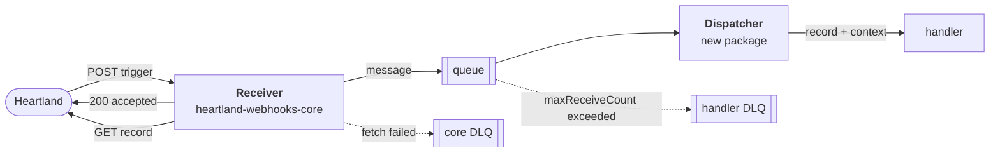
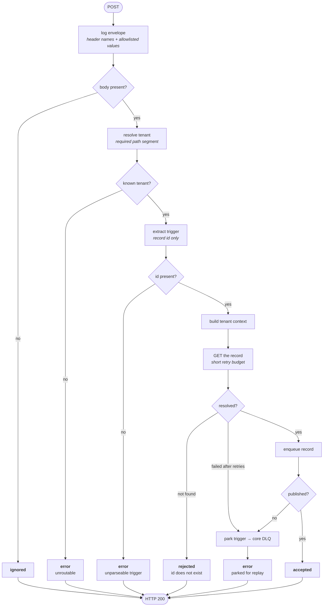
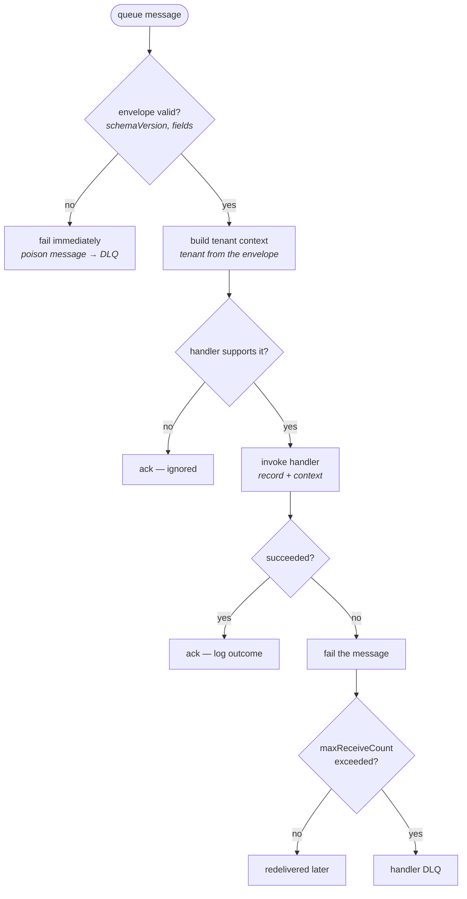

# 02 — Webhook pipeline

**This document describes the target state**, as decided by
[ADR-0006](../../design/adr/0006-webhook-is-a-trigger-api-is-truth.md) (a webhook
is a trigger; the API is the source of truth) and
[ADR-0007](../../design/adr/0007-asynchronous-processing-with-dlqs.md)
(asynchronous processing). The `0.1.0` code is synchronous and acts on the
payload. [What is implemented](#status-against-the-code) at the end maps every
stage to its gap issue.

One inbound event crosses two deployables:



## Receiver

Runs inside the webhook request. Its whole job is to turn an untrusted trigger
into a validated record on a queue, fast.



### Why this order

**Tenant before trigger parse**, unchanged in spirit from `0.1.0`: an unroutable
request is a configuration problem and deserves to be reported as itself. The
tenant is a required path segment
([ADR-0011](adr/0011-tenant-id-required-in-webhook-url.md)), so this is a cheap
string operation.

**Parse before context.** Extracting an id is free; building a context may load
a secret.

**Context before fetch**, necessarily — the fetch uses that tenant's
credentials. This is also the ordering change worth noticing: in `0.1.0` the
handler's `supports()` ran before the context was built, which let an unwanted
event cost nothing. There is no `supports()` here any more; it belongs to the
handler, and the handler is in another process
([ADR-0007](../../design/adr/0007-asynchronous-processing-with-dlqs.md)). The
receiver therefore pays for a context and a fetch on every routable trigger.

**Fetch before enqueue.** This is the point of the design: the fetch validates
the id *and* supplies the data. A trigger that names nothing real never reaches
the queue.

### The trigger parse is deliberately tiny

A trigger parser reads the record id and nothing else. The rich normalization in
`parseItemCreatedBody` — forty fields mapped from `snake_case` to camelCase —
feeds nothing once the record comes from the API, because handlers consume the
API's representation. The parsers stay `ParseResult`-returning and
non-throwing ([ADR-0006](adr/0006-parse-results-not-exceptions.md)); they just
have far less to do.

### Response statuses

Always HTTP 200 ([ADR-0002](adr/0002-always-200.md)). `status` is still the field
to assert on, and the vocabulary grows a term because "we accepted this for
later" is now distinct from "we did it":

| `status` | Means | Where the work is |
| --- | --- | --- |
| `accepted` | Record fetched and enqueued | on the queue |
| `ignored` | Nothing to do — no body | nowhere, correctly |
| `rejected` | The id does not resolve. A bogus or stale trigger | nowhere, correctly |
| `error` | We failed: fetch or publish | core DLQ, if parking succeeded |

`rejected` is worth separating from `error`: it is the expected answer to a
forged or stale trigger, and conflating it with our own failures would bury the
one signal that distinguishes "someone is poking at us" from "Heartland is
down".

Handler results no longer appear here at all. There is nothing to report
synchronously, so `WebhookOutcome.details` becomes a logging concern
([ADR-0010](adr/0010-bound-outcome-details.md)).

### Publishing stays behind an injected seam

Core does not import an AWS SDK. Publishing is a function the caller supplies,
exactly as `getToken` is:

```ts
interface EventPublisher {
  publish(message: QueueMessage): Promise<void>;
  park(trigger: ParkedTrigger): Promise<void>;   // → core DLQ
}
```

The deployment module supplies the SQS-backed implementation; tests supply an
array. This keeps [ADR-0004](adr/0004-zero-runtime-dependencies.md) intact —
without it, "receive a webhook and enqueue" would be the change that put the AWS
SDK into core's `dependencies` and its cold start.

### Retry budget

Short, because it is on the synchronous path: a couple of fast attempts, total
budget in the low seconds. Durability comes from the core DLQ, not from retrying
harder inside the request
([ADR-0007](adr/0007-outbound-http-timeouts-and-retries.md), as amended). A 401
still reloads the tenant context once
([ADR-0008](adr/0008-reload-context-on-401.md)), and that reload is not part of
the retry count.

## Queue message

The contract between the two deployables. Versioned, because it is the one shape
both packages must agree on across independent deploys.

```ts
interface QueueMessage {
  schemaVersion: 1;
  eventType: 'sales_transaction_completed' | 'item_created';
  tenantId: string;
  recordId: number;
  record: unknown;        // the API's representation, snake_case, verbatim
  receivedAt: string;     // ISO 8601 — when the trigger arrived
  fetchedAt: string;      // ISO 8601 — when the record was read
  idempotencyKey: string; // `${tenantId}:${eventType}:${recordId}`
}
```

Notes that matter:

- **`record` is verbatim API output.** Core does not reshape it. Those objects
  round-trip back to Heartland on updates, and translating in both directions
  invites field-name drift
  ([04 — Conventions](04-conventions.md#naming-across-the-boundary)).
- **`idempotencyKey` is safe for today's two event types** because a transaction
  id and an item id each identify a one-time event. It would be wrong for an
  `item_updated` event, where the same record changes repeatedly — that key
  would collapse distinct updates. Adding such an event means revisiting this
  field, not reusing it.
- **`receivedAt` and `fetchedAt` are both kept.** The gap between them is the
  receiver's latency; the gap between `fetchedAt` and processing time is how
  stale the record may be by the time a handler acts.
- SQS caps a message at 256 KB. A Heartland record is far smaller, but a future
  event type carrying line items should check rather than assume.

## Dispatcher

Its own package and its own Lambda, so its own timeout, memory, and concurrency.



**`supports()` runs here**, with the full record available — more accurate than
in `0.1.0`, where it saw only the payload. The cost is that unwanted events
still occupy the queue and a fetch. If that ever matters, the receiver takes a
declarative filter from configuration, never a copy of handler logic.

**The tenant comes from the envelope**, not from a URL. The tenancy layer is
otherwise identical: same `TenantRegistry`, same lazy memoized contexts, same
client construction ([01 — Multi-tenancy](01-multi-tenancy.md)).

**Failure is expressed by failing the message.** The handler retries its own
work; when exhausted it throws, and the message is left to SQS redelivery until
`maxReceiveCount` sends it to the handler DLQ by redrive policy. Note the
asymmetry with the receiver, which writes to the core DLQ *explicitly* because
it is not consuming a queue and has no redrive policy to lean on.

**A malformed envelope is a poison message** and must not be retried — it will
never parse. It goes to the DLQ on the first attempt.

Two SQS footguns to get right in the deployment, not in this package:

- **Visibility timeout must exceed the handler Lambda's timeout.** If it does
  not, a message is redelivered while the first attempt is still running, and a
  non-idempotent handler does its work twice.
- **Batch size.** With a batch larger than one, a single failure retries the
  whole batch unless partial batch failures are reported. Start at one.

## Idempotency is not optional here

Queue delivery is at-least-once, a redelivered message re-runs the handler from
the start, and a replayed trigger can fetch a real record again
([ADR-0006](../../design/adr/0006-webhook-is-a-trigger-api-is-truth.md)). A
handler whose action is not naturally idempotent needs its own guard; the
cheapest answer for replication is to *set* state to what Heartland says rather
than *adjust* it by a delta. See
[invariant 5](../../design/03-invariants.md) and the system-level
[open questions](../../design/05-open-questions.md).

Two messages for the same record can also be in flight at once — ordering is
mostly self-correcting because each reads current truth, but simultaneity is
not. A FIFO queue with the record id as the message group is the lever if it
bites.

## Logging shape

Tags accumulate through `logger.child()`, and the deployable is the first tag so
a line says which process it came from:

```
[clutch][receiver][sales_transaction_completed]   envelope, routing, fetch, publish
[clutch][receiver][bamherndon][heartland-api]     the authoritative fetch
[clutch][dispatcher][bamherndon]                  handling, outcomes, handler errors
```

Queue depth and both DLQ depths are the health signals that matter once this
lands. A receiver that answers `accepted` tells you nothing about whether the
work happened.

## Status against the code

`0.1.0` implements the single synchronous pipeline in `src/lambda/pipeline.ts`:
envelope log → tenant → parse → `supports()` → context → invoke handler →
respond with the outcome. Mapping that to the target:

| Target behaviour | In `0.1.0` | Gap |
| --- | --- | --- |
| Trigger-only parse | Full payload normalized | [#15](https://github.com/bamherndon/Clutch/issues/15) |
| Authoritative fetch; `rejected` on unresolvable id | Payload trusted as data | [#15](https://github.com/bamherndon/Clutch/issues/15) |
| Enqueue via injected publisher; `accepted` response | Handler invoked inline | [#16](https://github.com/bamherndon/Clutch/issues/16) |
| Core DLQ on fetch/publish failure | Event lost | [#16](https://github.com/bamherndon/Clutch/issues/16) |
| Dispatcher package consuming the queue | — | [#17](https://github.com/bamherndon/Clutch/issues/17) |
| `supports()` in the dispatcher | In the receiver | [#17](https://github.com/bamherndon/Clutch/issues/17) |
| Handler takes the API record; outcome to logs | Takes parsed payload; outcome in the response | [#18](https://github.com/bamherndon/Clutch/issues/18) |
| Queue, DLQs, visibility timeout, throttling | — | [#19](https://github.com/bamherndon/Clutch/issues/19) |
| Receiver factory names, `accepted`/`rejected` statuses, queue types exported, per-deployable log tags | Synchronous names and shapes | [#25](https://github.com/bamherndon/Clutch/issues/25) |

Two earlier issues were amended rather than superseded by this: [#8](https://github.com/bamherndon/Clutch/issues/8)
(the timeout stands; retry budgets now split between a short one in the receiver
and a patient one in the handler) and
[#11](https://github.com/bamherndon/Clutch/issues/11) (the `details` cap applies
to logs, since the response no longer carries handler output).

Unchanged by all of this: tenancy ([01](01-multi-tenancy.md)), the Heartland
client ([03](03-heartland-client.md)), and every convention in
[04](04-conventions.md).
