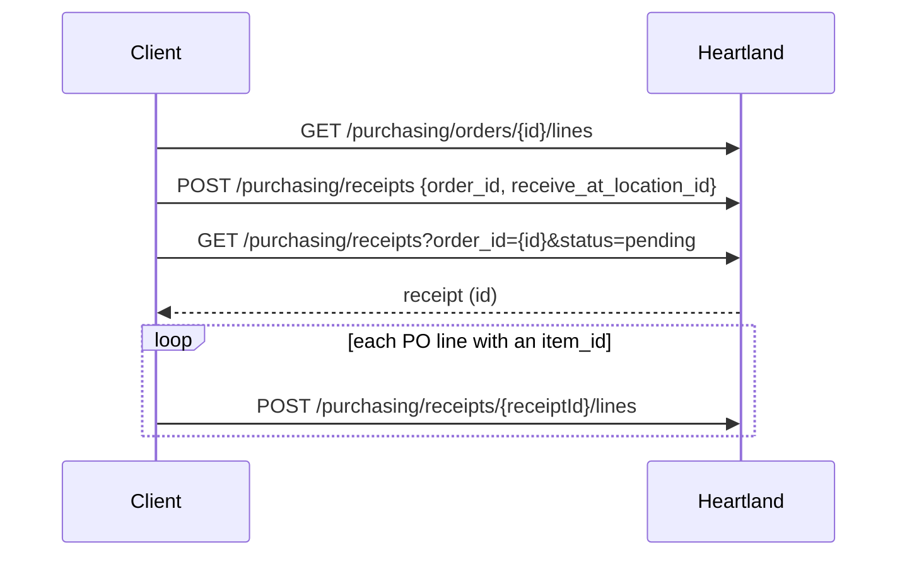

# 03 — Heartland client

Two files: `src/clients/http.ts` is the transport, `src/clients/heartland-api-client.ts`
is the typed Heartland surface built on it. API docs: <https://dev.retail.heartland.us/>.

## `requestJson` — the single call site

Every outbound HTTP request in the package goes through one function. Having
exactly one place that talks to the network is what makes auth, error text, and
JSON handling uniform without a framework.

```ts
requestJson<T>(url, { method, token | authorization, headers, body, api }): Promise<T>
```

Design points:

- **Built on `node:https`.** No `fetch` polyfill, no `axios` — see
  [ADR-0004](adr/0004-zero-runtime-dependencies.md).
- **Resolves with the parsed body, `{}` for an empty 2xx response.** Callers
  that only care about success (`createReceipt`) do not have to special-case a
  blank body.
- **Rejects with status *and* raw body** on non-2xx: `HTTP 422 from Heartland API: {...}`.
  Heartland's validation detail is in the body, so discarding it would make
  failures undiagnosable from logs alone — which is the only diagnostic channel
  Clutch has.
- **`api` label** names the service in error messages, so the same helper can
  serve future non-Heartland integrations and still produce readable errors.
- **`token` or `authorization`, never both** — rejected if both are passed. The
  raw `authorization` escape hatch exists for schemes Bearer cannot express
  (e.g. OAuth 1.0a) in future outbound integrations.
- **`Content-Length` is computed** from the serialized body, not left to chunked
  encoding, because some upstreams reject chunked POSTs.

Known gaps, both in [06 — Open questions](06-open-questions.md): no timeout and
no retry. A hung Heartland connection currently ends at the Lambda timeout, and
a 5xx fails the webhook outright.

### URL helpers

`buildUrl(base, pathWithQuery)` tolerates slashes on either side, so a tenant's
configured `baseUrl` may or may not have a trailing slash without anyone having
to care.

`buildQueryString(query)` **repeats the key for array values** (`group[]=item_id&group[]=location_id`)
rather than comma-joining, because that is what Heartland's reporting API
expects. Everything is `encodeURIComponent`-escaped; `undefined` values are
dropped so optional parameters can be passed unconditionally.

## `HeartlandApiClient`

An interface, with `DefaultHeartlandApiClient` as its HTTP implementation. The
interface exists so tests and non-AWS callers can substitute a fake via
`TenantRegistry`'s `clientFactory` — core's own tests never touch the network.

**One instance is bound to one tenant's base URL and token.** It holds no tenant
switch and no credential lookup; a multi-tenant deployment holds one client per
tenant, built by the registry. This is the property that makes it impossible for
a handler to accidentally call the wrong store: the only client it can reach is
the one on its own context. It matters precisely because the *handler* is shared
across tenants — the client is what is not.

A tenant registered without `getToken` gets a stand-in that rejects every call
rather than a real client; see
[01 — Multi-tenancy](01-multi-tenancy.md#tenants-without-credentials).

### Surface

Grouped by the automations that drove each method in:

**Sales**
- `getTicketLines(ticketId)` — `per_page=500`, enough for any realistic till ticket in one call.

**Inventory**
- `getInventoryValues(itemId)` — grouped by item and location, empty locations excluded.
- `getInventoryItem(itemId)`
- `updateInventoryItem(itemId, updates)` — `Partial<InventoryItem>`, PUT.
- `updateInventoryItemImage(itemId, imageUrl)` — POST `{ source: 'url', url }`.

**Purchasing / receiving**
- `listPurchaseOrders(status, page = 1)`
- `getPurchaseOrderLines(purchaseOrderId)`
- `createReceipt(purchaseOrderId, locationId)`
- `getReceiptByOrderId(orderId)` — first *pending* receipt; throws if none.
- `addReceiptLine(receiptId, line)`
- `createReceiptFromPurchaseOrder(purchaseOrderId, locationId)` — the composite.
- `completeReceipt(receiptId)` — PUT `status: 'accepted'`.

**Reporting**
- `runReport<T>(reportType, query)`

The surface grows when an automation needs an endpoint. It is not an attempt at
full API coverage.

### `createReceiptFromPurchaseOrder`

The one method with real logic in it, and the one place core comes closest to
business rules. It is here rather than in a handler because the *sequence* is
imposed by the Heartland API, not by any store's policy:



Two details that are not obvious from the endpoint names:

- **`POST /receipts` does not return the created receipt**, so its id has to be
  re-fetched by `order_id` with `status=pending`. That round trip is a Heartland
  constraint, not an oversight.
- **Lines without an `item_id` are skipped.** Heartland uses them for comments
  and other non-stock rows, which cannot be received. Each skip logs at `debug`.

Lines are added sequentially rather than in parallel — ordering is preserved and
a large PO cannot burst Heartland's rate limits.

### Reporting UUID

`runReport` injects `request_client_uuid: crypto.randomUUID()` into every query.
Heartland requires a unique client UUID per reporting request; generating it
inside the client means no caller can forget. `HeartlandReportQuery` is an alias
for `QueryParams`, so report filters are passed as plain records and the array
repetition rule applies automatically.

## Types

`src/clients/heartland-types.ts` models responses as `PaginatedResponse<T>`
(`results`, `total`, `pages`) with named aliases per endpoint (`TicketLinesResponse`,
`PurchaseOrdersResponse`, …). These are **partial models by design**: only the
fields Clutch reads are declared, in Heartland's own `snake_case`, and the
payloads stay loose enough that unmodelled fields do not break parsing. Compare
with `src/model/item.ts`, which is camelCased precisely because the item parser
normalizes it — see [04 — Conventions](04-conventions.md#naming-across-the-boundary).
